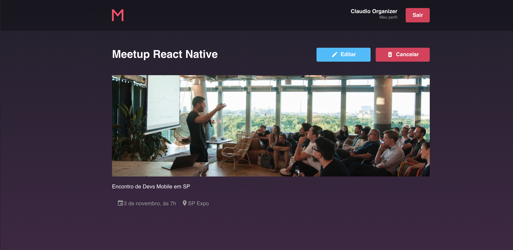

# MeetApp

An app to organize, browse, and subscribe to developer meetups (Meetup + App), built as the final challenge of Rocketseat's bootcamp.

## Repositories

MeetApp is split into three parts. Each one lives in its own repository.

| Part | Stack | Repository |
| --- | --- | --- |
| Backend | Node.js | [meetapp-api](https://github.com/tgmarinho/meetapp-api) |
| Web | React | [meetapp-react](https://github.com/tgmarinho/meetapp-react) |
| Mobile | React Native | [meetappRN](https://github.com/tgmarinho/meetappRN) |

## Stack

- **Backend:** Node.js with PostgreSQL, MongoDB, and Redis.
- **Web:** React with Redux.
- **Mobile:** React Native with Redux.

## Author

Thiago Marinho

- [tgmarinho@gmail.com](mailto:tgmarinho@gmail.com)
- [tgmarinho.com](http://tgmarinho.com)
- [twitter/tgmarinho](http://twitter.com/tgmarinho)
- [github.com/tgmarinho](http://github.com/tgmarinho)
- [linkedin.com/in/tgmarinho](http://linkedin.com/in/tgmarinho)

## License

MIT License. Anyone can use this project.
